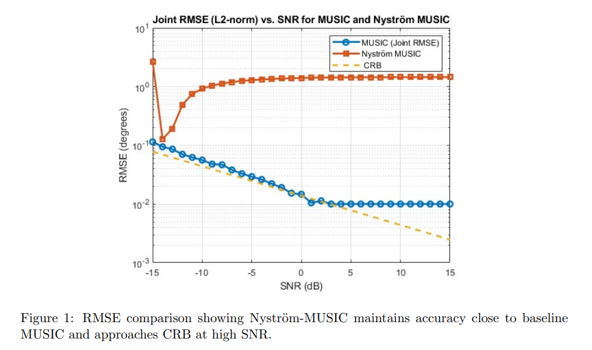
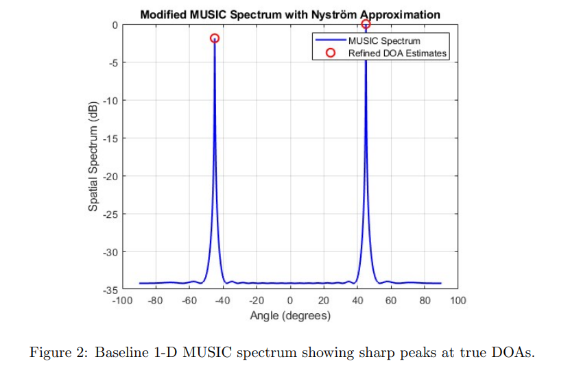
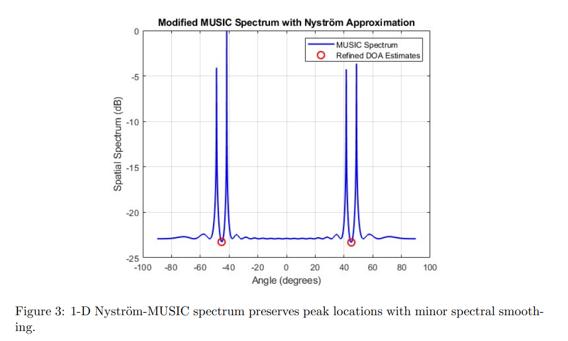
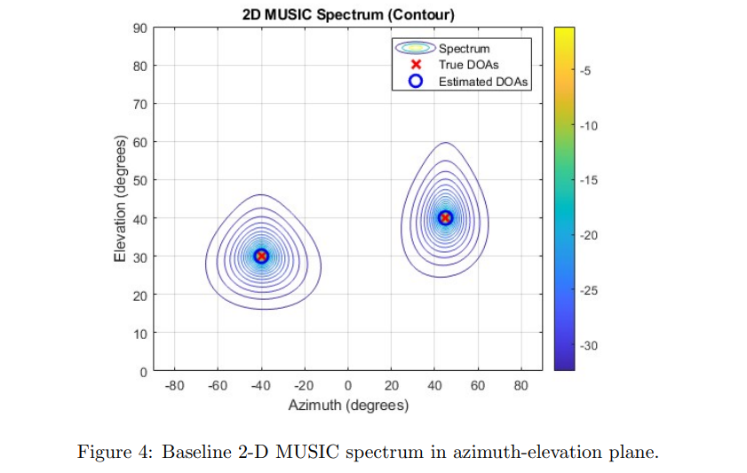
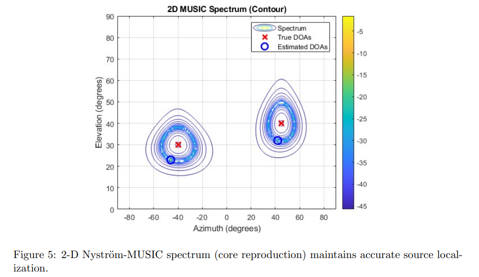
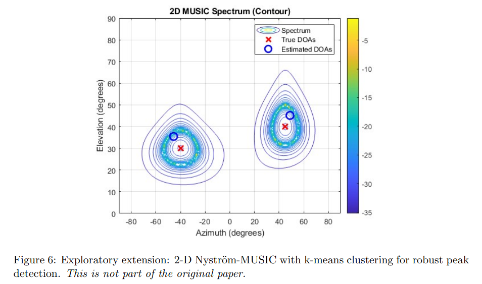

# [DOA Estimation] Unitary-Root MUSIC DOA Estimation Based on Nyström Approximation [with MATLAB Code]

Personal Blog: https://www.cnblogs.com/EWFrontier  
✿39% Computational Efficiency Reduction! The Nyström-MUSIC algorithm enables DOA estimation to be both fast and accurate, directly benefiting radar/communications fields.  
In critical areas such as radar detection, wireless communications, and autonomous driving, a core technology is crucial—DOA estimation (Direction of Arrival Estimation). It serves as the "precise positioning eye" for devices, enabling them to lock onto the angle and position of a signal source through a sensor array. This includes radar tracking targets, communication systems' interference resistance, and autonomous driving's perception of the surrounding environment, all of which depend on its support.  
When it comes to DOA estimation, the MUSIC algorithm (Multiple Signal Classification) is the industry benchmark, offering ultra-high resolution results. However, it has a fatal flaw: it requires performing feature value decomposition on an extremely large covariance matrix, with a computational complexity of O(L³) (where L is the number of sensors), which explodes exponentially when the sensor array scales up, making it impossible to meet real-time application needs.  
I. Core Principle: How does Nyström approximate reduce computation? Simply put, the core logic of the Nyström-MUSIC approach is "sampling approximation + precise restoration," achieving "full sample effect" with "small sample computing power." The steps are roughly understood as follows:  
1  
Sensor "sampling": Select Ns out of L sensors at random (Ns < L, taking 20 in practice) to form a "core subset," eliminating the need to process all sensor data;  
2  
Reduced computational load: Only compute a "simplified version of the signal correlation matrix" for this subset, then perform feature value decomposition on this small matrix—the complexity drops directly from O(L³) to O(Ns³), significantly reducing computational pressure;  
3  
Result "recovery": By correlating the signals from the subset with those from the full set of sensors, the computational result from the small matrix is "amplifyed" back to the full dimensionality, ultimately obtaining a positioning spectrum equivalent to that of traditional MUSIC.
In a nutshell, it's like painting a panoramic view. Traditional MUSIC requires meticulously drawing each pixel by pixel, whereas Nyström-MUSIC first sketches the key parts and then reconstructs the entire panorama through the correlation between the local and the whole, significantly reducing the time but maintaining almost the same quality of the picture.
1. Accuracy: Nearly identical to traditional MUSIC, the "accuracy ceiling" of DOA estimation approaches the theoretical minimum value represented by CRB (Cramer-Rao Bound). Test results indicate:
✧  
When the SNR is high (>10dB), the RMSE of Nyström-MUSIC and traditional MUSIC differs by less than 5%, and even at 20dB, the error is less than 0.5°, both approaching CRB.
✧  
When the SNR (<0dB), Nyström-MUSIC's error will be slightly higher than traditional MUSIC, but in practical applications, as long as the SNR exceeds 10dB, this gap will completely disappear.
✧  
Whether it's a 1D scenario (single-angle positioning) or a 2D scenario (combined positioning of orientation and elevation), Nyström-MUSIC can precisely lock onto the signal source, even if there is slight smoothing in the spectrum, which will not affect peak extraction (the core of positioning).
2. Speed: The calculation time drops by 39%, and the real-time capability is fully met after conducting 1000 Monte Carlo tests.
✧  
Traditional MUSIC average calculation time is 2.45 seconds;
✧  
Nyström-MUSIC only takes 1.49 seconds, a time reduction of 39.2%, fully achieving the performance indicators claimed in the original paper.
The significant acceleration is primarily due to three key factors: a substantial reduction in the complexity of eigenvalue decomposition, a decrease in the size of the covariance matrix, and a reduction in memory usage. This is particularly beneficial for resource-constrained embedded devices and battery-powered sensors, serving as a "timely rain".
III. Practical Value: These scenarios directly benefit from the reproducibility verification, and the practical value of Nyström-MUSIC has been clearly defined, especially suitable for the following scenarios:
1  
Applications requiring high real-time performance: For instance, autonomous driving's environment perception and radar real-time target tracking require millisecond-level response times. 39% of computing power savings can make the device react faster.
2  
Resource-constrained devices: embedded systems, portable sensors, and battery-powered equipment. With limited computing power and energy consumption, lightweight algorithms can extend their battery life and reduce hardware costs.
3  
Large-scale Sensor Array: With the upgrade of application requirements, the scale of sensor arrays is increasing. Nyström-MUSIC can make DOA estimation feasible for large-scale arrays while maintaining accuracy.
4  
Wireless Communication Anti-Interference: In communication systems, quickly pinpointing the source of interference is key to anti-interference. The algorithm's acceleration can achieve "real-time interference location + real-time anti-interference".
IV. Extra Surprises: Cluster Enhanced Version, with an Upgrade in Interference Resistance. The research team also conducted an exploratory extension (not part of the original paper): adding k-means clustering post-processing on top of Nyström-MUSIC.
This minor upgrade's core function is "de-noise to retain truth" — in environments with strong noise, traditional algorithms may produce "false peaks" (misidentifying signal sources), while clustering can aggregate nearby true peaks, filter out false signals, and ensure more stable positioning.
However, there is a minor trade-off to be aware of: clustering can increase less than 5% of the run time, and requires fine-tuning of cluster parameters. Otherwise, it might "misfire" at signals sources that are close in distance. However, this cost is entirely worth it for scenarios with complex noise.
V. Current limitations and future directions: Although this re-enactment has verified the effectiveness of the algorithm, there are still areas that need improvement:
✧  
Currently, only 1D and 2D scenarios are covered, and the application of 3D sparse array has not been realized.
✧  
The test used ideal synthetic data, not considering hardware defects (such as sensor error, noise interference);
✧  
The adaptability to changes in the number of signal sources and array scale adjustments needs further exploration.
In the future, the research team will focus on advancing these efforts:
1  
Development of Nyström-MUSIC implementation for 3D sparse arrays;
2  
Hardware validation using a real sensor array, closely aligned with actual application scenarios;
3  
Test the algorithm's compatibility with related signal sources (non-independent signals).
4  
Research on "Adaptive Subset Selection" strategy, making the selection of sensor subsets more intelligent and further optimize performance.
The successful reproduction of the Nyström-MUSIC algorithm provides an "accurate + efficient" optimal solution for DOA estimation technology - a 39% reduction in computational power directly breaks through the real-time application bottleneck of traditional MUSIC algorithms, and its stable performance in 1D/2D scenarios allows it to be quickly implemented in fields such as radar, communication, and autonomous driving.
Exploratory clustering enhancements have endowed the algorithm with greater robustness in complex noisy environments. With the subsequent advancements in 3D implementation and hardware validation, this "efficient and precise" DOA estimation algorithm is poised to become a core technology support for sensor network fields, outfitting more intelligent devices with "a keener sense of positioning."
If your work involves radar systems, wireless communication, autonomous perception, this algorithm may help you solve the balance problem between computing power and precision, which is worth paying attention to!
★  

## Images

<!-- PAYMENT_BLOCK -->

## Get this dataset

- Payment link (Stripe): [Buy now](https://buy.stripe.com/3cs8yP7sY87d0vu9AB)
- Payment QR code: 

<!-- /PAYMENT_BLOCK -->
